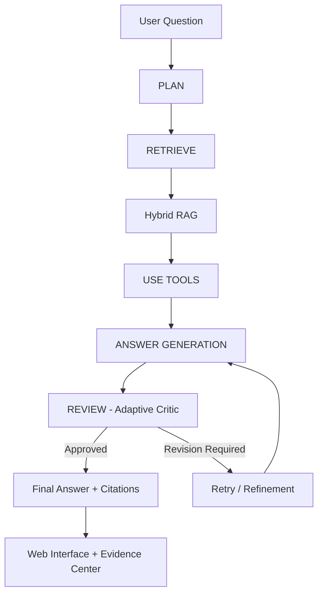

# PharmaGraph AI
### Evidence-Grounded Pharmaceutical Research Assistant

PharmaGraph AI is an agentic AI application designed to assist pharmaceutical research through structured reasoning, hybrid document retrieval, specialized tools, and evidence-based answer validation.

Unlike a traditional chatbot, PharmaGraph AI orchestrates a multi-stage workflow that plans research tasks, retrieves relevant pharmaceutical evidence, invokes domain-specific tools, reviews generated answers, and provides traceable source citations.

> **Disclaimer:** This application is intended for research and educational purposes only. It is not a clinical decision-support system and must not replace professional medical advice.

---

## 1. Key Features

- **LangGraph orchestration:** Structured multi-stage agent workflow.
- **Hybrid RAG:** Combines semantic embeddings with lexical retrieval.
- **Adaptive Critic:** Reviews generated responses and can trigger additional attempts.
- **Dynamic tool selection:** Invokes specialized pharmaceutical tools according to the question.
- **Evidence-grounded answers:** Includes references to retrieved pharmaceutical documents.
- **Agent traceability:** Exposes planning, retrieval, tool execution, critic feedback, and retry information.
- **Interactive web interface:** Provides a conversational research experience with supporting evidence.
- **Docker deployment:** Containerized FastAPI application.

---

## 2. Agent Architecture



### Workflow

**PLAN → RETRIEVE → USE TOOLS → REVIEW → ANSWER**

1. **Plan:** Analyze the question and identify research steps.
2. **Retrieve:** Search the local pharmaceutical corpus using hybrid retrieval.
3. **Use Tools:** Execute specialized tools based on the research requirements.
4. **Review:** Evaluate the generated response using an adaptive critic.
5. **Answer:** Return an evidence-grounded response with citations and execution trace.

The system supports iterative refinement when the critic identifies issues requiring revision.

---

## 3. Hybrid Retrieval-Augmented Generation

The retrieval component combines:

- **Semantic retrieval:** Embedding-based similarity for contextual relevance.
- **Lexical retrieval:** Keyword-based matching for precise pharmaceutical terminology.
- **Retrieval fusion:** Combines complementary search signals to select supporting evidence.

This approach helps retrieve both conceptually relevant passages and exact medical terminology.

---

## 4. Pharmaceutical Research Tools

PharmaGraph AI provides specialized tools for:

| Tool | Purpose |
|------|---------|
| `contraindication_lookup` | Identify documented drug contraindications |
| `renal_safety_check` | Investigate renal-function-related medication restrictions |
| `interaction_analysis` | Analyze documented drug interaction warnings |
| `evidence_comparison` | Compare evidence across medications or sources |

Tool execution is selected according to the question rather than following a fixed tool sequence.

---

## 5. Evidence Sources

The application uses a local pharmaceutical research corpus containing **21 Markdown documents**:

- 10 DailyMed drug-label documents
- 10 MedlinePlus medication-information documents
- 1 pharmaceutical glossary

The corpus covers medications including:

- Warfarin
- Apixaban
- Metformin
- Sertraline
- Aspirin
- Ibuprofen
- Acetaminophen
- Amoxicillin
- Atorvastatin
- Albuterol

Generated responses reference retrieved evidence passages to support factual claims.

---

## 6. Technology Stack

| Layer | Technology |
|-------|------------|
| Backend | Python, FastAPI |
| Agent orchestration | LangGraph |
| LLM integration | OpenAI-compatible API |
| Retrieval | Semantic embeddings + lexical search |
| Answer validation | LLM-based adaptive critic |
| Frontend | HTML, CSS, JavaScript |
| Deployment | Docker |
| Evaluation | Python benchmark script |

---


## Authentication and Persistent Conversation History

PharmaGraph AI provides administrator authentication and persistent conversation history.

### Administrator Authentication

- Secure password verification using PBKDF2-HMAC-SHA256.
- Signed session cookies with an eight-hour expiration.
- Protected research and conversation API endpoints.
- Administrator login and logout.
- Session-based access control.

### SQLite Conversation History

Research conversations are stored in a persistent SQLite database.

Each conversation preserves:
- User questions and generated answers.
- Scientific citations and supporting evidence.
- Executed pharmaceutical tools.
- Adaptive Critic feedback and retry information.

The conversation history remains available after page refresh, logout, login, and Docker container recreation.

### Conversation API

| Method | Endpoint | Description |
|---|---|---|
| GET | /conversations | List saved conversations |
| POST | /conversations | Create a conversation |
| GET | /conversations/{id} | Retrieve conversation history |
| DELETE | /conversations/{id} | Delete a conversation |
| POST | /ask | Execute research and save the response |

### Persistent Docker Storage

Create a named Docker volume:

    docker volume create pharmagraph_data

Build the application:

    docker build -t agent .

Start the container:

    docker run -d --rm --name pharmagraph -p 127.0.0.1:8000:8000 -v pharmagraph_data:/app/data -e DATABASE_PATH=/app/data/pharmagraph.db --env-file .env agent

The database is stored at /app/data/pharmagraph.db inside the container.

### Authentication Environment Variables

Configure these variables in your local .env file:

    ADMIN_EMAIL=admin@pharmagraph.local
    ADMIN_PASSWORD_HASH=<generated_password_hash>
    SESSION_SECRET=<random_session_secret>
    SESSION_HTTPS_ONLY=false
    DATABASE_PATH=/app/data/pharmagraph.db

Never commit real credentials, password hashes, session secrets, or API keys.


### Administrator Setup

Before running the application, copy `.env.example` to `.env` and configure your LLM credentials, `ADMIN_EMAIL`, `ADMIN_PASSWORD_HASH`, and `SESSION_SECRET`.

Generate a password hash using PBKDF2-HMAC-SHA256 with 600,000 iterations and a random 16-byte salt. Store it as `salt_hex:hash_hex`. Generate a random session secret using `secrets.token_urlsafe(48)`.

For local execution, set `DATABASE_PATH=data/pharmagraph.db`. For Docker, use `DATABASE_PATH=/app/data/pharmagraph.db` and mount a persistent volume at `/app/data`.

Never commit `.env` or share credentials.

### Security Considerations

This authentication implementation is intended for local demonstration. Production deployment requires HTTPS, login rate limiting, CSRF protection, and additional security hardening.

---

## 7. Installation

### Requirements

- Python 3.11 or compatible environment
- Docker (optional)
- Access to a compatible LLM and embedding API

### Local Setup

Clone the repository and navigate to the project directory.

Create a virtual environment:

```bash
python3 -m venv .venv
source .venv/bin/activate
```

Install dependencies:

```bash
pip install -r requirements.txt
```

Create the environment configuration:

```bash
cp .env.example .env
```

Configure the following variables in `.env`:

```env
OPENAI_API_KEY=your_api_key
OPENAI_BASE_URL=your_api_base_url
OPENAI_MODEL=your_chat_model
OPENAI_EMBEDDING_MODEL=your_embedding_model
```

Never commit your actual `.env` file.

Start the application:

```bash
python -m uvicorn app.main:app --reload
```

Open the application at:

- Web interface: `http://localhost:8000`
- API documentation: `http://localhost:8000/docs`
- Health check: `http://localhost:8000/health`

---

## 8. Docker Deployment

Build the Docker image:

```bash
docker build -t pharmagraph-ai .
```

Create a persistent Docker volume:

```bash
docker volume create pharmagraph_data
```

Start the container:

```bash
docker run --rm \
  --name pharmagraph-ai \
  -p 127.0.0.1:8000:8000 \
  -v pharmagraph_data:/app/data \
  -e DATABASE_PATH=/app/data/pharmagraph.db \
  --env-file .env \
  pharmagraph-ai
```

Open:

`http://localhost:8000`

---

## 9. API Usage

### POST /ask

The `/ask` endpoint requires administrator authentication. First, log in using your configured `ADMIN_EMAIL` and password:

```bash
curl -c cookies.txt -X POST http://localhost:8000/auth/login \
  -H "Content-Type: application/json" \
  -d '{"email":"admin@pharmagraph.local","password":"YOUR_ADMIN_PASSWORD"}'
```

Replace the email and password with your own administrator credentials. Then reuse the session cookie for the research request:

```bash
curl -b cookies.txt -X POST http://localhost:8000/ask \
  -H "Content-Type: application/json" \
  -d '{"question":"Is metformin contraindicated at an eGFR of 25?"}'
```

The API returns:

- `question`: Original research question
- `answer`: Generated evidence-grounded response
- `sources`: Supporting pharmaceutical evidence
- `agent_trace`: Agent execution information
- `disclaimer`: Medical safety disclaimer

The agent trace includes:

- Research plan
- Search queries
- Executed tools
- Critic approval status
- Critic feedback
- Retry count

---

## 10. Evaluation

The application was evaluated using four pharmaceutical research scenarios.

| Test Scenario | Duration | Evidence Sources | Critic Approved | Retries |
|---------------|----------|------------------|-----------------|---------|
| Warfarin contraindications | 51.79 s | 4 | Yes | 0 |
| Warfarin vs. Apixaban | 33.53 s | 5 | Yes | 1 |
| Warfarin + Sertraline interaction | 15.32 s | 11 | Yes | 0 |
| Metformin with eGFR 25 | 9.18 s | 3 | Yes | 0 |

**Observed technical success rate: 4/4 requests (100%) in this limited benchmark.**

All four requests returned answers with supporting evidence, and the critic approved the final responses.

The comparative contraindication scenario required one retry, illustrating the review-and-refinement capability.

These results are specific to the tested environment and do not constitute clinical validation or a guarantee of medical accuracy.

### Run the Benchmark

Start the application, then execute:

```bash
python tests/benchmark.py
```

Results are saved locally to:

`tests/benchmark_results.json`

---

## 11. Project Structure

```text
pharma-agent-starter/
├── app/
│   ├── agent/
│   ├── rag/
│   ├── static/
│   └── main.py
├── corpus/
├── tests/
│   └── benchmark.py
├── .env.example
├── .gitignore
├── Dockerfile
├── requirements.txt
└── README.md
```

---

## 12. Limitations

- The pharmaceutical corpus is limited to the supplied documents.
- Retrieval quality depends on document coverage and relevance.
- Generated answers may contain inaccuracies despite critic validation.
- The critic is an automated quality-control mechanism, not a clinical expert.
- The system does not provide personalized treatment recommendations.
- Medical decisions must be reviewed by qualified healthcare professionals.

---

## 13. Future Improvements

Potential extensions include:

- Larger and regularly updated pharmaceutical knowledge bases
- More extensive evaluation datasets
- Automated citation verification
- Retrieval quality metrics
- Latency and cost optimization
- Additional pharmaceutical research tools

---

## 14. Project Context

Developed as part of the **Syntax GenAI pharmaceutical research assistant assignment**.

The project demonstrates the integration of agentic AI orchestration, retrieval-augmented generation, specialized tool execution, evidence traceability, and automated answer review.

---

## Medical Disclaimer

PharmaGraph AI is intended exclusively for research and educational purposes.

It is not medical advice, is not clinically validated, and must not be used as a substitute for consultation with a qualified healthcare professional.
EOFcat > README.md <<'EOF'
# PharmaGraph AI
### Evidence-Grounded Pharmaceutical Research Assistant

PharmaGraph AI is an agentic AI application designed to assist pharmaceutical research through structured reasoning, hybrid document retrieval, specialized tools, and evidence-based answer validation.

Unlike a traditional chatbot, PharmaGraph AI orchestrates a multi-stage workflow that plans research tasks, retrieves relevant pharmaceutical evidence, invokes domain-specific tools, reviews generated answers, and provides traceable source citations.

> **Disclaimer:** This application is intended for research and educational purposes only. It is not a clinical decision-support system and must not replace professional medical advice.

---

## 1. Key Features

- **LangGraph orchestration:** Structured multi-stage agent workflow.
- **Hybrid RAG:** Combines semantic embeddings with lexical retrieval.
- **Adaptive Critic:** Reviews generated responses and can trigger additional attempts.
- **Dynamic tool selection:** Invokes specialized pharmaceutical tools according to the question.
- **Evidence-grounded answers:** Includes references to retrieved pharmaceutical documents.
- **Agent traceability:** Exposes planning, retrieval, tool execution, critic feedback, and retry information.
- **Interactive web interface:** Provides a conversational research experience with supporting evidence.
- **Docker deployment:** Containerized FastAPI application.

---

## 2. Agent Architecture


### Workflow

**PLAN → RETRIEVE → USE TOOLS → REVIEW → ANSWER**

1. **Plan:** Analyze the question and identify research steps.
2. **Retrieve:** Search the local pharmaceutical corpus using hybrid retrieval.
3. **Use Tools:** Execute specialized tools based on the research requirements.
4. **Review:** Evaluate the generated response using an adaptive critic.
5. **Answer:** Return an evidence-grounded response with citations and execution trace.

The system supports iterative refinement when the critic identifies issues requiring revision.

---

## 3. Hybrid Retrieval-Augmented Generation

The retrieval component combines:

- **Semantic retrieval:** Embedding-based similarity for contextual relevance.
- **Lexical retrieval:** Keyword-based matching for precise pharmaceutical terminology.
- **Retrieval fusion:** Combines complementary search signals to select supporting evidence.

This approach helps retrieve both conceptually relevant passages and exact medical terminology.

---

## 4. Pharmaceutical Research Tools

PharmaGraph AI provides specialized tools for:

| Tool | Purpose |
|------|---------|
| `contraindication_lookup` | Identify documented drug contraindications |
| `renal_safety_check` | Investigate renal-function-related medication restrictions |
| `interaction_analysis` | Analyze documented drug interaction warnings |
| `evidence_comparison` | Compare evidence across medications or sources |

Tool execution is selected according to the question rather than following a fixed tool sequence.

---

## 5. Evidence Sources

The application uses a local pharmaceutical research corpus containing **21 Markdown documents**:

- 10 DailyMed drug-label documents
- 10 MedlinePlus medication-information documents
- 1 pharmaceutical glossary

The corpus covers medications including:

- Warfarin
- Apixaban
- Metformin
- Sertraline
- Aspirin
- Ibuprofen
- Acetaminophen
- Amoxicillin
- Atorvastatin
- Albuterol

Generated responses reference retrieved evidence passages to support factual claims.

---

## 6. Technology Stack

| Layer | Technology |
|-------|------------|
| Backend | Python, FastAPI |
| Agent orchestration | LangGraph |
| LLM integration | OpenAI-compatible API |
| Retrieval | Semantic embeddings + lexical search |
| Answer validation | LLM-based adaptive critic |
| Frontend | HTML, CSS, JavaScript |
| Deployment | Docker |
| Evaluation | Python benchmark script |

---

## 7. Installation

### Requirements

- Python 3.11 or compatible environment
- Docker (optional)
- Access to a compatible LLM and embedding API

### Local Setup

Clone the repository and navigate to the project directory.

Create a virtual environment:

```bash
python3 -m venv .venv
source .venv/bin/activate
```

Install dependencies:

```bash
pip install -r requirements.txt
```

Create the environment configuration:

```bash
cp .env.example .env
```

Configure the following variables in `.env`:

```env
OPENAI_API_KEY=your_api_key
OPENAI_BASE_URL=your_api_base_url
OPENAI_MODEL=your_chat_model
OPENAI_EMBEDDING_MODEL=your_embedding_model
```

Never commit your actual `.env` file.

Start the application:

```bash
python -m uvicorn app.main:app --reload
```

Open the application at:

- Web interface: `http://localhost:8000`
- API documentation: `http://localhost:8000/docs`
- Health check: `http://localhost:8000/health`

---

## 8. Docker Deployment

Build the Docker image:

```bash
docker build -t pharmagraph-ai .
```

Start the container:

```bash
docker run --rm \
  --name pharmagraph-ai \
  -p 127.0.0.1:8000:8000 \
  -v pharmagraph_data:/app/data \
  -e DATABASE_PATH=/app/data/pharmagraph.db \
  --env-file .env \
  pharmagraph-ai
```

Open:

`http://localhost:8000`

---

## 9. API Usage

### POST /ask

Example request:

```bash
curl -b cookies.txt -X POST http://localhost:8000/ask \
  -H "Content-Type: application/json" \
  -d '{"question":"Is metformin contraindicated at an eGFR of 25?"}'
```

The API returns:

- `question`: Original research question
- `answer`: Generated evidence-grounded response
- `sources`: Supporting pharmaceutical evidence
- `agent_trace`: Agent execution information
- `disclaimer`: Medical safety disclaimer

The agent trace includes:

- Research plan
- Search queries
- Executed tools
- Critic approval status
- Critic feedback
- Retry count

---

## 10. Evaluation

The application was evaluated using four pharmaceutical research scenarios.

| Test Scenario | Duration | Evidence Sources | Critic Approved | Retries |
|---------------|----------|------------------|-----------------|---------|
| Warfarin contraindications | 51.79 s | 4 | Yes | 0 |
| Warfarin vs. Apixaban | 33.53 s | 5 | Yes | 1 |
| Warfarin + Sertraline interaction | 15.32 s | 11 | Yes | 0 |
| Metformin with eGFR 25 | 9.18 s | 3 | Yes | 0 |

**Observed technical success rate: 4/4 requests (100%) in this limited benchmark.**

All four requests returned answers with supporting evidence, and the critic approved the final responses.

The comparative contraindication scenario required one retry, illustrating the review-and-refinement capability.

These results are specific to the tested environment and do not constitute clinical validation or a guarantee of medical accuracy.

### Run the Benchmark

Start the application, then execute:

```bash
python tests/benchmark.py
```

Results are saved locally to:

`tests/benchmark_results.json`

---

## 11. Project Structure

```text
pharma-agent-starter/
├── app/
│   ├── agent/
│   ├── rag/
│   ├── static/
│   └── main.py
├── corpus/
├── tests/
│   └── benchmark.py
├── .env.example
├── .gitignore
├── Dockerfile
├── requirements.txt
└── README.md
```

---

## 12. Limitations

- The pharmaceutical corpus is limited to the supplied documents.
- Retrieval quality depends on document coverage and relevance.
- Generated answers may contain inaccuracies despite critic validation.
- The critic is an automated quality-control mechanism, not a clinical expert.
- The system does not provide personalized treatment recommendations.
- Medical decisions must be reviewed by qualified healthcare professionals.

---

## 13. Future Improvements

Potential extensions include:

- Larger and regularly updated pharmaceutical knowledge bases
- More extensive evaluation datasets
- Automated citation verification
- Retrieval quality metrics
- Latency and cost optimization
- Additional pharmaceutical research tools

---

## 14. Project Context

Developed as part of the **Syntax GenAI pharmaceutical research assistant assignment**.

The project demonstrates the integration of agentic AI orchestration, retrieval-augmented generation, specialized tool execution, evidence traceability, and automated answer review.

---

## Medical Disclaimer

PharmaGraph AI is intended exclusively for research and educational purposes.

It is not medical advice, is not clinically validated, and must not be used as a substitute for consultation with a qualified healthcare professional.
